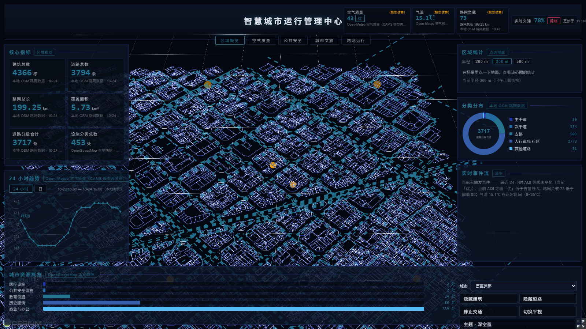
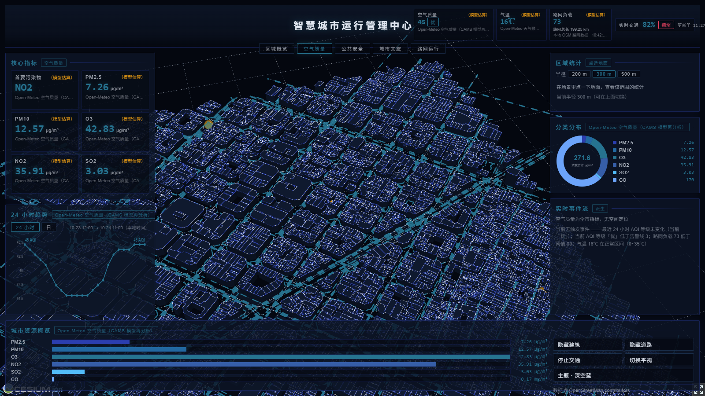
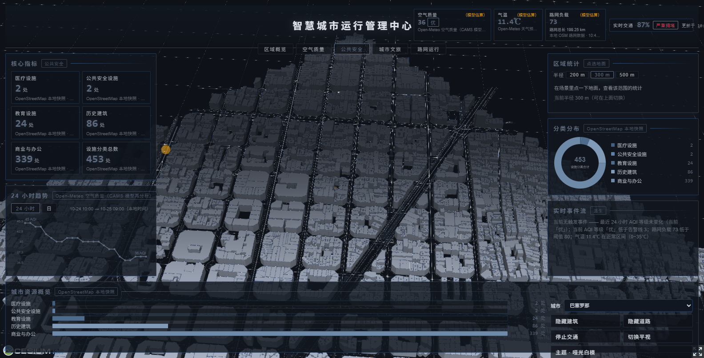
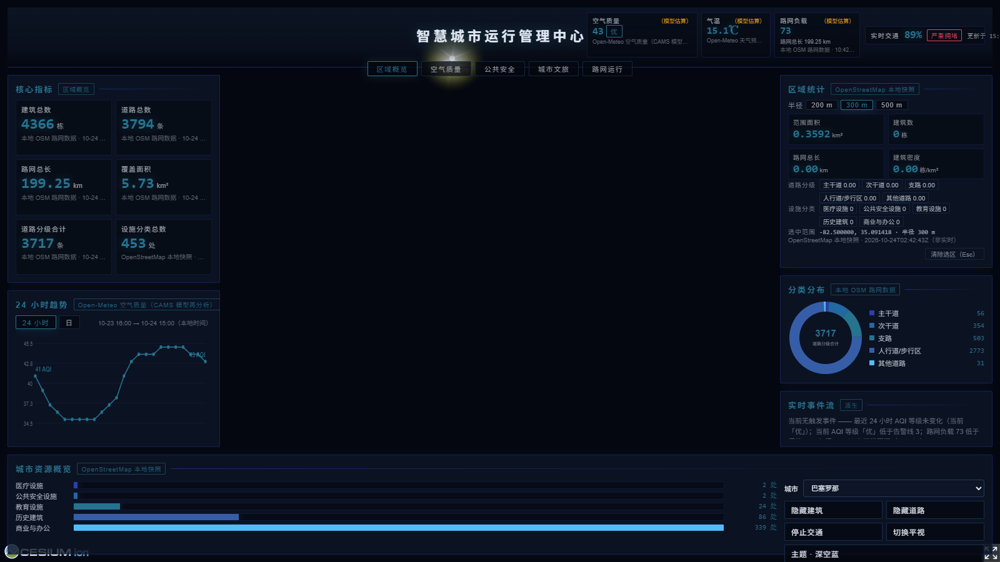

# 智慧城市 3D 可视化平台

<p align="center">
把 OpenStreetMap 的建筑与道路数据，变成可环视、可查询、可下钻的三维城区
</p>



中心城区的一小块 OpenStreetMap 建筑与道路，在浏览器里成了一座可以环视、可以查询、
可以点进去的城市；四周的面板给出这片区域的运行指标与派生事件。
场景是**巴塞罗那 Eixample 街区与圣家堂**一带约 1.7 km × 1.9 km 的范围。
底栏右侧可以切到**米兰**（`?city=milano`）与**纽伦堡**（`?city=nuernberg`）——
这两个链接就是那两座城的固定链接，可以直接分享。

## 它能做什么

**看清整片区域。** 深色三维底座：建筑按真实高度拉伸，道路按等级分级发光，相机缓慢环绕。
底座自绘，打开即是，不加载任何瓦片服务。

**按页签切换关注点。** 顶栏 5 个页签 —— 区域概览、空气质量、公共安全、城市文旅、路网运行。
每个页签给出对应的指标卡、分类构成与趋势图；切页签时场景同步高亮该类别的建筑，其余压暗。

**看趋势，不只看当下。** 左列的趋势面板支持 **24 小时**与**逐日**两个视图：
逐日视图给出最近 7 个完整本地日的 AQI 与六项污染物日均值，可逐项切换。
时间都是本地时间，取不到数据时显示空态，不画一条假的平线。

**点一下地面，查那片范围。** 在三维场景里单击地面，右列立刻给出这一片的建筑数、路网总长、
道路分级、设施分类与建筑密度。半径可选 200 / 300 / 500 m；点的是哪个位置、范围多大，
面板上都写着，数字与接口返回逐字一致。

**知道每个数字的来路。** 空气质量与气温来自公开数据源，建筑与道路来自本地 OSM 抽取。
每张指标卡标着来源名与观测时间；模型估算项单独标注；某个源取不到时显示「数据源暂不可用」，
不用 0 或旧值顶替。

**追到具体位置。** 事件流里的每条都由真实指标派生 —— 空气质量等级变化、当前空气质量超阈、
路网负载超阈、极端天气。场景里用告警脉冲环与垂直光柱标出位置，点一条就飞过去。
没有告警系统时事件流为空，并说明是哪些条件没触发。

**自己挑一套配色。** 底栏的主题入口切换四套预设 —— 哑光白模（默认）、深空蓝、石墨灰、深海青。
道路主色与建筑本体色可以自己取，辉光强度与路面不透明度可以拖动，改完立刻生效。
换主题只改材质上的颜色值，不重建任何几何 —— 4366 栋楼与 3794 条路的图元原地不动。

**走到街上去。** 底栏「切换平视」把相机放到 1.7 m 的人眼高度，拖拽转向；
在鸟瞰视角下**按住 Alt**可以临时落到街上漫游 —— WASD 移动、Shift 跑、Ctrl 冲刺，
松开 Alt 飞回鸟瞰。撞墙会沿墙滑动，不会穿模：碰撞用的是本地那 4366 栋楼的多边形。
视场角在街上放宽到 75°，比鸟瞰的 60° 更接近人在街上的感觉。

**今天的天气就渲染在街上。** 气温、湿度、降水量与风速来自公开气象源，
直接驱动场景：下雨有雨幕、雪天飘雪、湿度高时远处的雾变浓、路面变湿变暗。
底栏还有一个「天气」按钮，能在自动 / 雨 / 雪 / 雾之间手动切换 ——
不是每天都在下雨，但汇报与验收时随时能看效果。

**自己跑起来。** 生产形态下后端进程同时提供接口与页面，一个 uvicorn 进程即可。

## 界面预览

### 空气质量



六项污染物在环形图里统一换算成 μg/m³ 才能相加，底栏的条形图则各自保留原单位。
AQI 是按国标 GB/T 3095-2012 的分段表**自己换算**的（24 小时滑动平均，O₃ 取 8 小时），
不是任何机构发布的 AQI —— 换算口径写在 `backend-python/city_data/aqi.py` 里。

### 公共安全



切到这个页签，医疗、公共安全与教育设施所在的那几栋楼被点亮，其余建筑的描边压暗 ——
城市还在，注意力收到了该看的地方。

### 区域统计



在场景里单击地面，面板给出这一片的范围面积、建筑数、路网总长与建筑密度，
外加道路分级和设施分类的分解。半径可选 200 / 300 / 500 m；
面板上标着选中的坐标与数据来源，数字与接口返回逐字一致。

### 主题


底栏的主题入口切换四套预设 —— 哑光白模（默认）、深空蓝、石墨灰、深海青。
道路主色与建筑本体色可以自己取，辉光强度与路面不透明度可以拖动。
预警橙与告警红是语义色，跨主题恒定，不在自选范围内。

**建筑是主体，不是路网。** 「哑光白模」那一套把权重反了过来：建筑本体是哑光浅灰的体块，
道路退成比建筑更暗的细线，流动光效层压到几乎看不见。深色底 + 浅建筑，
像建模软件里的白模，但不与深色大屏面板打架。

## 快速开始

需要 Python 3.12+、Node 20.19+ 或 22.12+。**不需要注册任何 key，也不需要 API 凭据。**

```bash
# 1. 取数据（输出到 backend-python/geojson/，不入库）
cd backend-python
python -m venv .venv
./.venv/Scripts/python.exe -m pip install -r requirements.txt -r requirements-dev.txt
./.venv/Scripts/python.exe scripts/fetch_osm_data.py

# 2. 前端依赖
cd ../Data-driven-modeling && npm install
```

开发时两端各自跑：

```bash
cd backend-python      && ./.venv/Scripts/python.exe main.py     # http://127.0.0.1:8000
cd Data-driven-modeling && npm run dev                          # http://localhost:5173/
```

生产形态只要一个进程：

```bash
cd Data-driven-modeling && npm run build     # 产物在 dist/
cd backend-python      && ./.venv/Scripts/python.exe main.py
# http://127.0.0.1:8000/ 就是应用本身
```

> Linux / macOS 把 `./.venv/Scripts/python.exe` 换成 `./.venv/bin/python`。
> 抓取脚本的范围与注意事项见 `backend-python/scripts/README.md`。

### 配置

后端配置读 `backend-python/.env`（不入库，模板见 `backend-python/.env.example`）：

| 变量 | 默认 | 作用 |
|---|---|---|
| `PORT` | `8000` | 监听端口 |
| `DEBUG` | `True` | **生产必须 `False`** |
| `ALLOWED_ORIGINS` | `http://localhost:5173` | CORS 允许来源，逗号分隔 |
| `API_KEY` | 空 | 设了之后 `/api/buildings`、`/api/roads` 需要带 `X-API-Key` 头 |
| `EXPOSE_DOCS` | `False` | 是否暴露 `/docs` `/redoc` `/openapi.json` |
| `ALLOWED_HOSTS` | 空 | Host 头白名单，逗号分隔；留空不限制 |

## 数据来源

| 数据 | 地址 | 凭据 | 实时性 |
|---|---|---|---|
| AQI / 六项污染物浓度 / 24 小时序列 / 逐日序列 | `https://air-quality-api.open-meteo.com/v1/air-quality`（Open-Meteo · CAMS） | 免凭据 | 小时级；**CAMS 模型再分析值**，不是站点实测 |
| 气温 / 湿度 / 体感温度 / 风速 / 降水 | `https://api.open-meteo.com/v1/forecast`（Open-Meteo） | 免凭据 | 小时级；**数值模式预报**，不是站点实测 |
| 建筑 / 道路 / 路网 / 设施分类 / 区域统计 | 本地 OpenStreetMap 抽取 | 无 | 静态快照 |

- 场景是**西班牙巴塞罗那**的 Eixample 街区与圣家堂一带（约 1.7 km × 1.9 km）；
  底栏右侧可切到**米兰**（大教堂与老城）与**纽伦堡**（中世纪老城与城墙），
  `?city=milano` / `?city=nuernberg` 是它们的固定链接。
- **两个远程源都是模式数据**，所以它们的指标都标「（模型估算）」。
- AQI 是**按国标 GB/T 3095-2012 的分段表自己换算**的（24 小时滑动平均，O3 取 8 小时），
  **不是任何机构发布的 AQI** —— 换算口径写在 `backend-python/city_data/aqi.py` 里。
- 路网负载指数是**模型估算**（静态几何折算的供给紧张度，不是实测路况），界面上标「（模型估算）」。
- 端点不会因为某个上游挂了而报错 —— 该源降级，其余指标照常返回。

### 许可与署名

| 数据 | 许可 | 要求 |
|---|---|---|
| OpenStreetMap | ODbL | 界面里必须署名「© OpenStreetMap contributors」 |
| Open-Meteo | CC BY 4.0 | 必须署名 **Open-Meteo** 与 **CAMS ENSEMBLE** 数据提供方 |
| Open-Meteo 免费档 | —— | **仅限非商业用途**；商业用途需要付费档与 API key |

## 技术栈

| | |
|---|---|
| **后端** | Python 3.12 · FastAPI · Uvicorn · Pydantic v2 · Shapely |
| **前端** | Vue 3 · Vite 7 · TypeScript 5.9（严格模式）· Cesium 1.134 |
| **图表** | 手写 SVG（指标卡 / 折线 / 环形 / 条形 / 事件流），无图表库依赖 |
| **测试** | pytest + pytest-cov · Vitest + @vue/test-utils |

两端代码库完全分离，只通过 REST 通信。架构细节见 [`docs/ARCHITECTURE.md`](docs/ARCHITECTURE.md)。

## 目录

| 路径 | 内容 |
|---|---|
| `backend-python/main.py` | 应用装配、路由、响应缓存、gzip 与安全响应头 |
| `backend-python/data_processor.py` | GeoJSON 加载与 bbox 过滤 |
| `backend-python/city_data/` | 运行指标数据层：契约、聚合、公开数据源、派生事件 |
| `backend-python/scripts/` | OpenStreetMap 数据抓取 |
| `Data-driven-modeling/src/components/SmartCity.vue` | 场景装配层：把场景 composable、数据轮询与大屏骨架接起来 |
| `Data-driven-modeling/src/components/DashboardOverlay.vue` | 16:9 大屏骨架 |
| `Data-driven-modeling/src/components/dashboard/` | 大屏面板与图表组件 |
| `Data-driven-modeling/src/composables/` | 场景层（底座 / 相机 / 交通 / 事件标记 / 页签联动 / 区域统计）、取数、页签状态与纯函数 |
| `Data-driven-modeling/src/theme/` | 深色色板与大屏设计 token |
| `docs/ARCHITECTURE.md` | 架构说明与开发约定 |

## License

代码以 [Apache License 2.0](LICENSE) 发布。

数据来自 [OpenStreetMap](https://www.openstreetmap.org/copyright)，遵循 ODbL：
随应用展示这份数据时必须署名，界面里已常驻「数据 © OpenStreetMap contributors」署名行。
